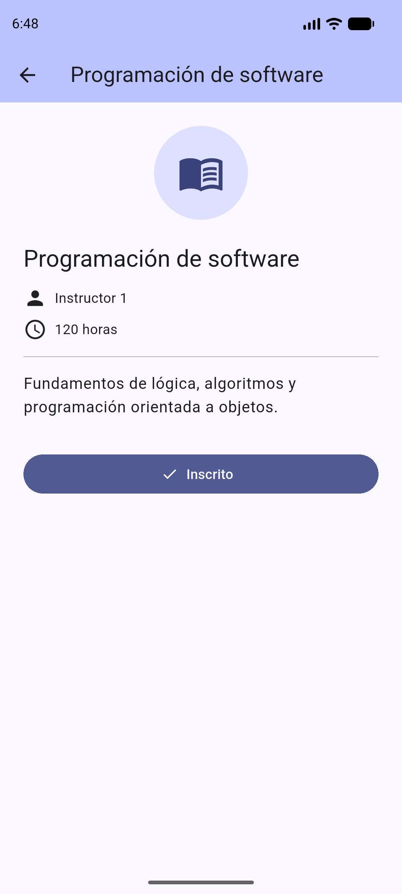

# Cursos ADSO - Aplicación Móvil en Flutter

## Integrantes
* **Emanuel Quintero Torres**

## Descripción de la App
**Cursos ADSO** es una aplicación móvil desarrollada en Flutter para la consulta y gestión de oferta académica. Permite a los usuarios iniciar sesión validando el formato de correo electrónico y contraseña, explorar el catálogo de cursos mediante un buscador dinámico en tiempo real y acceder al detalle de cada curso para realizar su inscripción con almacenamiento local de datos.

### Características principales
* **Inicio de sesión:** Validación de campos obligatorios y formato de correo electrónico.
* **Catálogo y búsqueda:** Listado interactivo de cursos con filtrado instantáneo.
* **Detalle e inscripción:** Visualización completa del programa y registro persistente de inscripción.

## Capturas de Pantalla

| Vista de Login | Vista de Lista de Cursos | Vista de Detalle |
| :---: | :---: | :---: |
|  |  |  |
